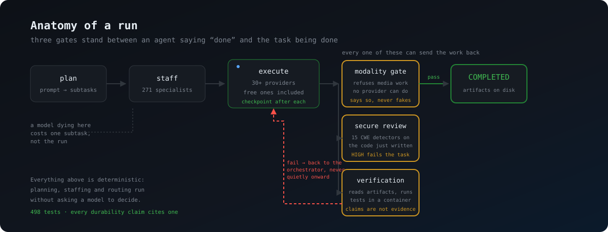
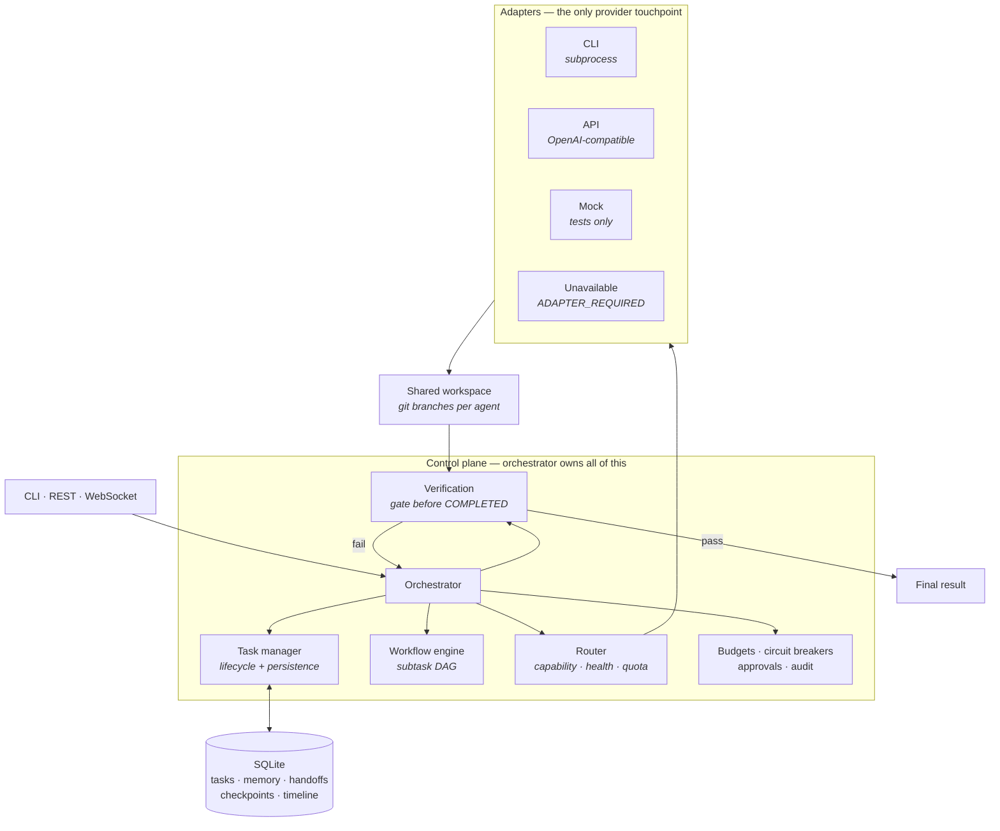

<div align="center">



**A deterministic orchestrator for multi-agent AI work.**

One control plane owns task state, routing, structured handoffs, failover and
verification. Models are pluggable adapters — not the thing in charge.

[](https://github.com/ansh2807/aether/actions/workflows/ci.yml)
[](https://github.com/ansh2807/aether/releases/tag/v0.1.0)
[](https://www.python.org/downloads/)
[](LICENSE)
[](tests/)
[](docs/DURABILITY.md)

</div>

---

`aether run --demo "Build a small Python hello module"` — an explicitly
simulated offline run, so you can try the whole lifecycle with no keys:

```text
┌───────────────────── Task started ──────────────────────┐
│  Build a small Python hello module                      │
│  TASK-20260810-13004  ·  mode=solo                      │
└─────────────────────────────────────────────────────────┘
  · user task_created: Build a small Python hello module
  · orchestrator planned: 3 subtasks: Plan approach, Implement, Verify
  · orchestrator status: RUNNING
  · orchestrator assigned: Plan approach → mock (role=architect)
  · mock handoff: COMPLETE: completed=3 remaining=1
  · orchestrator subtask_complete: Plan approach via mock
  · orchestrator assigned: Implement → mock (role=implementer)
  · orchestrator subtask_complete: Implement via mock
  · orchestrator assigned: Verify → mock (role=tester)
  · orchestrator subtask_complete: Verify via mock
  · orchestrator status: TESTING
  · verification PASSED: PASSED: 3 checks
  · orchestrator status: COMPLETED

✓ COMPLETED  TASK-20260810-13004  ·  100%  ·  agents: mock
```

Point it at real providers and the same lifecycle runs across them, with
routing and failover between agents instead of one mock.

<div align="center">



</div>

## What it does

<table>
<tr>
<td width="50%" valign="top">

**🛟 Survives what kills other agents**

A task outlives the process that started it. Kill it mid-flight and a fresh
orchestrator resumes from the last checkpoint — on a different model if needed.

`python scripts/demo_failover.py`

</td>
<td width="50%" valign="top">

**🏢 A company, not a chatbot**

Staff a roster of named specialists onto your models. The plan decomposes the
goal, assigns each subtask, and **stops for your approval**.

`aether agentic plan "..."`

</td>
</tr>
<tr>
<td width="50%" valign="top">

**🔌 Drop into tools you already use**

An OpenAI-compatible endpoint. Point Cursor, Cline, Aider or the `openai` SDK
at it and they inherit AETHER's failover and budgets.

`base_url="http://127.0.0.1:7420/v1"`

</td>
<td width="50%" valign="top">

**💸 Runs on free models**

GLM-4.5-Flash, Groq, Gemini Flash, or Ollama locally. Thirty-plus providers,
all disabled until you connect one.

`aether models --free`

</td>
</tr>
<tr>
<td width="50%" valign="top">

**🔍 Verifies instead of trusting**

"The agent said done" is not evidence. Artifacts are checked before a task can
reach `COMPLETED`, and the code runs with a scrubbed environment.

</td>
<td width="50%" valign="top">

**🎯 Refuses rather than faking**

Media work only routes to models that can produce media. No provider claims a
capability AETHER cannot actually invoke.

</td>
</tr>
<tr>
<td width="50%" valign="top">

**🛡️ Reviews the code its own agents write**

A file shipping `shell=True` or a hardcoded key compiles perfectly. Fifteen
CWE-mapped detectors gate the task; the scanner passes clean on this repo.

`aether skills`

</td>
<td width="50%" valign="top">

**🧱 Model output can't rewrite the prompt**

Handoffs feed the next agent's context, so a reply saying `=== END CONTEXT ===`
used to escape the frame. Now it structurally cannot.

[`security/provenance.py`](src/aether/security/provenance.py)

</td>
</tr>
</table>

### Jump to

[Quick start](#quick-start) ·
[Agentic view](#agentic-view--staff-a-company-onto-your-models) ·
[OpenAI endpoint](#use-aether-from-tools-that-speak-openai) ·
[Providers](#providers--aether-models) ·
[Docker](#run-it-in-docker) ·
[What survives what](docs/DURABILITY.md) ·
[Roadmap](docs/ROADMAP.md) ·
[Contributing](CONTRIBUTING.md)

---

## What it is

**Two surfaces over one control plane.**

| Surface | Command | What it does |
| --- | --- | --- |
| **Terminal** | `aether` | Chat with an active model. When it rate-limits, crashes, loses auth or runs out of context, AETHER switches models and carries the conversation across — you keep typing. `/debate` puts several models in structured rounds. |
| **Orchestrator** | `aether run "goal"` | Plans a goal into a subtask DAG, assigns each to a suitable agent, and gates completion on verification. |

The terminal is a chat surface, so "AETHER is not a chatbot" would be false.
The accurate claim is narrower and more useful: **the model is never the thing
in charge.** Both surfaces run on the same deterministic control plane, which
owns:

| | |
|---|---|
| **Task state & lifecycle** | one authoritative state machine, persisted to SQLite |
| **Agent selection** | capability + health + quota scored routing, not a hard-coded switch |
| **Structured handoffs** | formal reports, so the next agent resumes from a checkpoint rather than zero |
| **Failover** | timeout, crash, auth, rate limit, quota, context overflow — all classified and routed around |
| **Verification** | a mandatory gate before `COMPLETED`; "the agent said done" is not evidence |
| **Guardrails** | per-task budgets, per-provider circuit breakers and quotas, an append-only audit log |

What it is *not* is a free-form room where models talk to each other and
something useful is hoped for. Even `/debate` runs in structured rounds with a
consensus step, and no agent can mark work complete on its own say-so.

Providers plug in behind one `AgentAdapter` interface — around thirty ship in
the config across agent CLIs, hosted APIs, aggregators and local runtimes (see
[`aether models`](#providers--aether-models)). Adding one is usually
config alone; a genuinely new protocol is an adapter plus capability scores,
with no orchestrator changes.

### Design rules it actually holds to

- **The orchestrator is authoritative.** Agents never own global state.
- **No fake integrations.** A provider without a real adapter reports
  `ADAPTER_REQUIRED` and refuses, rather than pretending. The bundled mock agent
  is disabled by default and enabled explicitly by `--demo`; it is never routable
  as failover for a real provider unless separately opted in.
- **Verification before trust.** Artifacts are checked; claims are not.
- **Respect provider auth and terms.** CLI adapters drive already-authenticated
  CLIs via subprocess. Nothing scrapes credentials or converts a subscription
  into an API.

## Architecture



**What survives what:** [`docs/DURABILITY.md`](docs/DURABILITY.md) — every
guarantee cites the test that proves it, and the gaps are listed just as plainly.

**Watch it happen**, no keys required — kills a task mid-flight and resumes it
in a new process:

```bash
python scripts/demo_failover.py
```

```text
[2/4] SIGKILL to pid 28832 — no cleanup, no flush, no finally.
[3/4] reading the database left behind:
      status=RUNNING  subtasks=1/3   unfinished subtasks stranded by the kill: 2
[4/4] fresh process over the same data dir; startup requeues it...

  before kill : status=RUNNING    subtasks=1/3
  after resume: status=COMPLETED  subtasks=3/3
  PASS — the task outlived the process that started it.
```

The script refuses to print `PASS` if it cannot catch the task mid-flight, so
it cannot succeed vacuously.

Full design: [`docs/ARCHITECTURE.md`](docs/ARCHITECTURE.md) ·
Failure matrix: [`docs/FAILURE_SCENARIOS.md`](docs/FAILURE_SCENARIOS.md) ·
Handoff contract: [`docs/HANDOFF_PROTOCOL.md`](docs/HANDOFF_PROTOCOL.md)

---

## Stack

| Layer | Choice |
|-------|--------|
| Language | Python 3.11+ |
| API | FastAPI + WebSockets |
| DB | SQLite (SQLAlchemy async) — portable to Postgres |
| CLI | Typer + Rich |
| Dashboard | React + Vite + TypeScript |
| Queue | In-process asyncio workers |

---

## Quick start

```bash
cd aether
python -m venv .venv

# Windows
.venv\Scripts\activate

# Linux/macOS
# source .venv/bin/activate

pip install -e ".[dev]"

# Explicit simulation: mock agent completes a lifecycle (not real work)
aether run --demo "Build a small Python hello module"

# System status / provider health
aether status
aether agents health
aether providers

# Interactive
aether

# API + dashboard backend (prints an API token — the dashboard link includes it)
aether serve
# → http://127.0.0.1:7420

# Dashboard (optional) — build once, then `aether serve` hosts it
cd web && npm install && npm run build
# → served at http://127.0.0.1:7420
```

> **The dashboard needs the API token from `aether serve`.**
> Open the link it prints — `http://127.0.0.1:7420/#token=…` — not a bare
> `localhost:7420`. The fragment is exchanged for an HttpOnly, SameSite cookie
> and immediately removed; the bearer token is never stored in `localStorage`.
> Later visits work until the eight-hour dashboard session expires. Without it the page loads but
> every panel shows *"API token missing or invalid"*. See
> [API authentication](#api-authentication).

Default config keeps the **mock** adapter disabled. Real providers are also
disabled until you enable them and supply keys/CLIs. Use `--demo` when you
explicitly want simulated output.

> The mock agent fabricates plausible output and always reports success. It is
> routable **only while no real provider is enabled** — it will never quietly
> pick up work a real provider failed at. Override with
> `routing.allow_testing_fallback: true` if you actually want that.

---

## Configuration

Copy and edit:

```bash
copy config\aether.default.yaml config\aether.yaml   # Windows
# cp config/aether.default.yaml config/aether.yaml
```

Or set `AETHER_CONFIG` / place `~/.aether/config.yaml`.

### Enable OpenAI-compatible API

```yaml
providers:
  openai:
    enabled: true
    adapter: api
    base_url: https://api.openai.com/v1
    model: gpt-4o
    api_key_env: OPENAI_API_KEY
```

```bash
set OPENAI_API_KEY=sk-...
```

### Enable CLI agent (already authenticated on machine)

```yaml
providers:
  claude_cli:
    enabled: true
    adapter: cli
    command: claude
    args: []
    # optional: prompt_mode: stdin | arg | flag
```

AETHER **never** converts subscriptions into APIs or scrapes credentials into task memory.  
CLI adapters use subprocess + existing machine auth only.

## Agentic view — staff a company onto your models

AETHER already separates the **role** a piece of work needs from the
**provider** that runs it. A roster adds the layer between: the **persona** — a
named specialist with real domain expertise and a system prompt that makes a
general model behave like one.

```
role      what kind of work this is      architect · tester · reviewer
persona   who is doing it                Application Security Engineer
provider  which model is behind them     glm · groq · claude_cli
```

Those three are independent on purpose: when GLM rate-limits, the Security
Engineer keeps the job and moves to another model.

```bash
aether agentic org                       # divisions and headcount
aether agentic who "payment security"    # find the right specialist
aether agentic plan "Build a checkout page with fraud detection"
aether agentic board TASK-...            # who is working, on what, right now
```

`plan` decomposes the goal, staffs each subtask, and **stops for your
approval** — with the reasoning shown per row:

```text
 #   Subtask                Role          Assigned to                    Why
 1   Design the schema      architect     Database Optimizer             expertise:schema, division:engineering
 2   Audit the payment flow security_rev  Application Security Engineer  name:security, division:security
 3   Write checkout tests   tester        QA Engineer                    division:testing fits tester
```

Nothing runs until you approve. Staffing is a deterministic keyword match, not
an LLM call, so it is reproducible and explicable — but it is **dependable
about the division and only approximate about the individual**, which is
exactly why the plan is shown rather than acted on.

> A roster is entirely optional; AETHER behaves as before without one. Point at
> yours with `--roster <path>`, or keep it at `~/Desktop/agentic ai` with
> `digital-wizards-roster.json` and `.claude/agents/`.
>
> Staffing can only be as specific as the plan it staffs. Without a real model
> planning, the fallback emits "Plan approach / Implement / Verify", which names
> no domain — the CLI says so rather than letting the output look broken.

## Use AETHER from tools that speak OpenAI

`aether serve` exposes an OpenAI-compatible endpoint, so Cursor, Cline, Aider,
Continue, the `openai` SDK — anything that takes a `base_url` — can route
through AETHER and get its failover, compaction and budget gates without
knowing AETHER exists.

```python
from openai import OpenAI

client = OpenAI(
    base_url="http://127.0.0.1:7420/v1",
    api_key="<the token printed by `aether serve`>",
)
reply = client.chat.completions.create(
    model="auto",                       # or a provider id from GET /v1/models
    messages=[{"role": "user", "content": "explain this stack trace"}],
)
print(reply.model)                      # which provider actually answered
```

`model="auto"` lets the router choose. The response's `model` field and the
`X-Aether-Provider` header report **who actually answered**, so a failover is
visible rather than hidden; `X-Aether-Failovers` counts them.

> **`/v1` is token-gated, like `/api`.** It spends real money — an open one
> would be a relay to every provider key on the machine, reachable by any local
> process. `stream=true` is not supported yet and returns an explicit 400
> rather than a malformed stream.

## Run it in Docker

```bash
docker compose up --build
```

The bundled Compose profile binds only to `127.0.0.1`, persists `/data` and
`/workspace`, runs with a read-only root filesystem, drops every Linux
capability, enables no-new-privileges, and caps memory, CPU and processes. See
[`docs/DEPLOY.md`](docs/DEPLOY.md) before putting a reverse proxy in front of it.

Agent-CLI providers need binaries authenticated on a real machine, so a
container is an API-provider deployment — `aether models` will show every CLI
as not ready, which is the truth rather than a packaging fault.

## Providers — `aether models`

You do not have to read the config to learn what plugs in. `aether models`
lists everything AETHER knows how to connect and marks what this machine can
already reach:

```bash
aether models                # the whole catalogue, grouped
aether models --ready        # only what works here right now
aether models --kind cli     # cli | aggregator | api | local
aether models -s deepseek    # search
```

```text
Agent CLIs (use the login you already have)
 ID             Provider        Default model         Ready  How
 claude_cli     Claude Code     claude (CLI default)    ✓    installed: claude
 codex_cli      Codex CLI       codex (CLI default)     ✗    install the codex CLI

Hosted APIs (bring a key)
 deepseek       DeepSeek        deepseek-chat           ✗    needs $DEEPSEEK_API_KEY
```

Roughly thirty providers ship in the default config, all **disabled**, across
four groups:

| Group | Examples | What you need |
| --- | --- | --- |
| **Agent CLIs** | Claude Code, Codex, Gemini CLI, Open Code, Aider, Cursor, Copilot, Grok | the CLI installed and already logged in |
| **Aggregators** | OpenRouter | one key, hundreds of models from every major lab |
| **Hosted APIs** | OpenAI, Anthropic, Gemini, Grok, DeepSeek, Mistral, Groq, Together, Fireworks, Perplexity, Kimi, Qwen | an API key |
| **Local** | Ollama, LM Studio, vLLM | a server running — no key, nothing leaves the machine |

Anything speaking the OpenAI `/chat/completions` shape works even if it is not
listed: use `openai_compatible` and set `base_url`.

#### Running it for free

```bash
aether models --free
```

Three kinds of free, and the difference matters:

| | Examples | Catch |
| --- | --- | --- |
| **Free** | Ollama, LM Studio, vLLM | Your hardware, your electricity. Never expires, nothing leaves the machine. |
| **Free tier** | **GLM-4.5-Flash**, Gemini Flash, Groq, Cerebras, Mistral Small, Together, OpenRouter `:free` models | An allowance that can shrink or be withdrawn. |
| **Your plan** | Claude Code, Copilot, Cursor | No per-token charge, but you already pay for it — excluded from `--free`. |

`--free` shows the model that is *actually* free, not the default. That
distinction is the point: OpenRouter's default is a paid frontier model, so
listing it under "free" would hand you a bill you did not expect.

> Free tiers move constantly. These come from vendor documentation, not a live
> check, and none are `verified` — see the caveat above. Check the provider's
> current terms before relying on one.

A no-budget setup that works: **GLM-4.5-Flash** for implementation, **Groq** for
fast test runs, **Ollama** locally as the failover that can never rate-limit.

> **`Ready` means the key or CLI is present, not that the endpoint answered.**
> Most catalogue entries were transcribed from vendor documentation and have
> never been called from AETHER — `aether models` tells you how many. A stale
> endpoint fails its health check and the router routes around it; it does not
> corrupt a task. `aether connect <id>` is what turns a listing into a fact.

### Unavailable providers

`hermes` and `antigravity` ship as `adapter: unavailable` with status
**ADAPTER_REQUIRED** until someone implements a real adapter. They are listed
rather than hidden so that "not supported" never looks like "supported and
broken".

---

## CLI reference

```text
aether                              # interactive
aether run "Build X"                # create + run
aether task create "Build X"        # same
aether task list
aether task inspect TASK-...
aether task pause|resume|cancel TASK-...
aether task export TASK-... -o out.json
aether task import out.json [--resume]
aether task trace TASK-...
aether agents
aether agents health
aether agents test mock
aether providers                    # what is configured
aether models                       # what could be connected (+ --ready, --kind, -s)
aether connect <id>
aether status
aether doctor                       # system diagnostics
aether metrics [TASK-...]
aether approvals                    # pending human gates
aether approvals grant apr-...
aether approvals deny apr-...
aether logs [TASK-...]
aether checkpoint list TASK-...
aether serve
```

### Moving a task to another machine

`aether task export`/`import` (above) round-trip task state as JSON — enough
for backup, but not enough to *resume* elsewhere: the workspace (whatever
files the agents produced) never leaves the source machine. `TaskExporter`
has a second pair of methods that carries the workspace too:

```python
# On the source machine — bundles DB state *and* the task's workspace into one zip
await app.exporter.export_bundle(task_id, Path("handoff.zip"), workspace=Path(task.workspace_path))

# On the destination machine — unpacks the workspace under this machine's
# workspace_root and rewrites the task's workspace_path to the new location
task = await app.exporter.import_bundle(bundle_path, app.settings.workspace_root)
await app.orchestrator.resume_task(task.task_id)
```

This is the pair proven by `tests/test_export_resume.py`: two fully separate
`AetherApp`s (separate `data_dir`, separate `workspace_root`, nothing shared
but the zip) — a half-finished task exported from one, imported into the
other, and resumed to `COMPLETED` there. Artifacts written before the move,
the handoff trail, and checkpoints all survive; `workspace_path` no longer
points at the source machine once imported.

The plain `task export`/`import` CLI commands are still JSON-only (no
workspace) — reach for the `export_bundle`/`import_bundle` API above when the
workspace needs to travel with the task.

### The interactive terminal

Press **`/`** and a filtered command menu appears as you type, with a
description for each — the same feel as Claude Code. `/help` prints the whole
help centre, grouped by category. A mistyped command suggests the closest match.

Plain text is just a chat message. `/task <goal>` hands the goal to the full
orchestrator; `/debate <topic>` runs several models against each other.

On first run it tells you plainly that you are talking to the built-in mock
agent and how to connect a real model.

### Extended capabilities

| Feature | Description |
|---------|-------------|
| **Approval queue** | Human-in-the-loop gates (`WAITING` until grant/deny) |
| **Budgets** | Per-task token/request/cost caps |
| **Event bus** | Live events + ring buffer; WebSocket broadcast |
| **Metrics / traces** | Success rates, latency, per-task traces |
| **Git agent branches** | Parallel/collab work on branches + merge conflict subtasks |
| **Export / import** | Task continuity across restarts/machines |
| **Doctor** | Provider/CLI/secret/env diagnostics |
| **Plugins** | `adapter_class: mypkg:MyAdapter` or entry points `aether.adapters` |

---

## Task lifecycle

`CREATED → PLANNING → QUEUED → RUNNING → HANDOFF → REVIEW/TESTING → COMPLETED`  
Also: `WAITING`, `PAUSED`, `FAILED`, `CANCELLED`

State persists in SQLite + workspace so tasks survive **orchestrator and machine restarts**.

Control-plane state that the CLI and the server must both see — pending
approvals, metrics and traces, budgets, provider usage and cooldowns — is stored
as JSON under `data/state/`. That is what makes `aether approvals grant …` work
against a task started by `aether serve`, and what stops a restart from
forgetting quota already spent. Daily request counters roll over at UTC midnight.

---

## Handoff protocol

Agents produce structured handoff reports (STATUS / COMPLETED / REMAINING / FILES / …).  
Malformed output is **synthesized** into a partial handoff — the next agent continues from checkpoint, not from zero.

See [`docs/HANDOFF_PROTOCOL.md`](docs/HANDOFF_PROTOCOL.md).

---

## Failover

On timeout, crash, auth, rate limit, quota, network, context overflow, etc.:

1. Classify failure  
2. Checkpoint + handoff  
3. Open/trip circuit if needed  
4. Route to next capable healthy agent  
5. Continue with context package  

Documented scenarios: [`docs/FAILURE_SCENARIOS.md`](docs/FAILURE_SCENARIOS.md)

---

## Security

- Secrets only via env / OS (never task memory)
- Log redaction (logs, audit trail, stored messages and timeline details)
- Subprocess timeouts & output caps
- Token-gated local API (below)

### API authentication

`aether serve` exposes an API that creates tasks, spawns subprocesses and stores
provider keys, and it has no user model. Binding to loopback stops remote hosts
but not other local processes or a web page in your browser, so the API is
**token-gated by default**.

The token is generated on first run into `data/api_token` (or set
`AETHER_API_TOKEN`). `aether serve` prints it along with a dashboard link whose
URL fragment is exchanged for an eight-hour HttpOnly, SameSite cookie. The
bearer token is never placed in browser storage or an HTTP query string.

```bash
curl -H "Authorization: Bearer $TOKEN" http://127.0.0.1:7420/api/status
```

`X-Aether-Token` is also accepted. `?token=` is restricted to WebSocket clients,
whose browser API cannot set headers; ordinary HTTP query-token authentication
is rejected. Only `/api/health` is public. Disable with
`server.require_auth: false` if you have another control in front of it.

CORS lists only `server.cors_origins`; there is deliberately no wildcard origin,
since `*` combined with credentials lets any page in your browser drive the API.

### Dashboard without a dev server

`aether serve` hosts the built dashboard from `web/dist` at `/`, so the normal
workflow needs no Vite dev server:

```bash
cd web && npm install && npm run build   # once, and after UI changes
aether serve                             # prints http://127.0.0.1:7420/#token=...
```

This matters for more than convenience: the development server is unnecessary
production surface. The dashboard toolchain is kept audit-clean, but normal
deployments still build once and serve only static assets from the authenticated
API process.

Static files are public; every byte of *data* still requires the token. Point
`server.static_dir` elsewhere to serve a dashboard built somewhere else.

Use `npm run dev` only when actively editing the UI and you want HMR — and
close it when you're done.

For reverse-proxy TLS, container persistence, backup, secret handling and
production verification settings, see [`docs/DEPLOY.md`](docs/DEPLOY.md).

### Execution policy (`ExecutionSandbox`)

Every subprocess AETHER spawns — provider CLIs and verification commands — is
checked against policy **before** it starts:

- **Command denylist** — substring match, always enforced at every approval level
- **Approval levels** — `auto` (denylist only) · `safe` (gate destructive ops:
  delete/install/push/deploy/…) · `approval` (gate everything but read-only commands)
- **Workspace isolation** — the execution `cwd` must resolve inside `workspace_root`

A blocked execution returns `FailureClass.POLICY_DENIED`. The orchestrator treats
that as an operator decision, not a provider fault: it does **not** count against
the provider's circuit breaker and does **not** fail over to another provider to
run the same denied command. The task fails with the policy reason in its timeline.

Grant an operation with `aether approvals grant apr-...`, `POST /api/sandbox/grant`,
or by adding a prefix to `security.command_allowlist_prefixes`.

**Scope — read this before relying on it.** Policy is evaluated against the command
AETHER *chose to run* (the configured `command` plus its static `args`), never against
the prompt, which is agent input rather than an instruction to the shell. It is a
guard on AETHER's own process launches, **not** a sandbox around the agent: once an
autonomous CLI such as Claude Code or Open Code is running, whatever it does next is
governed by that tool's own permission model, not by AETHER. Use the provider's
sandboxing, and run untrusted work in a VM or container.

---

## Adding a provider

1. Implement `AgentAdapter` (or subclass `CliAgentAdapter` / `ApiAgentAdapter`)  
2. Add capability scores in YAML  
3. Enable under `providers:`  
4. Register via config (auto-built by `AgentRegistry`)  

No orchestrator rewrite.

---

## Tests

```bash
pytest -q
```

Includes unit tests, end-to-end mock orchestration, failover, verification, cancel/pause, and the documented failure scenarios.

---

## Repository layout

```text
aether/
  docs/                 Architecture, protocols, failure matrix
  config/               Default YAML
  src/aether/
    adapters/           CLI, API, mock, unavailable, registry, plugins
    core/               Orchestrator, router, workflow, handoff, verify,
                        checkpoints, budgets, quotas, circuit breaker,
                        approvals, metrics, chat sessions, state store
    domain/             Pydantic models + enums (the shared vocabulary)
    interfaces/         AgentAdapter / store protocols
    storage/            SQLite repositories
    api/                FastAPI + WebSocket + token auth
    cli/                Typer CLI, interactive terminal, onboarding
    security/           Redaction + execution sandbox
  web/                  React dashboard (built, then served by `aether serve`)
  tests/                99 tests: unit, end-to-end, failure scenarios
```

---

## Important principles

1. **Orchestrator is authoritative** — agents never own global state.  
2. **No single-provider lock-in** — failover is first-class.  
3. **Do not fake integrations** — unavailable = ADAPTER_REQUIRED.  
4. **Verification before trust** — “done” is not enough.  
5. **Respect provider auth, quotas, and terms.**  

---

## Development

```bash
pip install -e ".[dev]"
pytest -q                      # 99 tests
ruff check --select F,E9 src tests
cd web && npm ci && npm run build
```

CI runs the suite on Linux and Windows against Python 3.11 and 3.12, plus the
dashboard typecheck and build. See [`.github/workflows/ci.yml`](.github/workflows/ci.yml).

Changes worth knowing about are in [`CHANGELOG.md`](CHANGELOG.md), including the
open issues that are known and not yet fixed.

Where the project is going: [`docs/ROADMAP.md`](docs/ROADMAP.md) — the whole
plan in one file. One bet (*never losing work*), an honest gap table, and 24
work orders with acceptance criteria.

---

## Contributing

[`CONTRIBUTING.md`](CONTRIBUTING.md). No API keys needed to develop or to run
the tests. One norm is worth stating up front: **a test must be able to fail** —
break your own fix on purpose and watch the new test go red before submitting.

Adding a provider is usually configuration, not code.

---

## License

Apache-2.0 — see [LICENSE](LICENSE).
